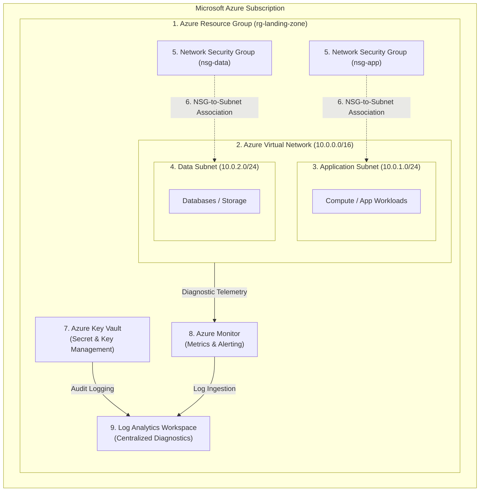
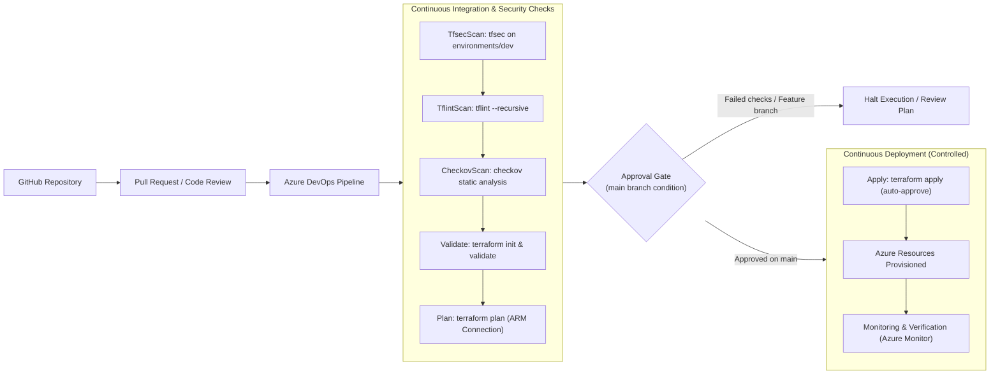

<!-- ANIMATED CAPSULE RENDER HEADER -->

<!-- TYPING ANIMATION -->

 

<!-- HEADLINE & SUBTITLE -->
<h3>DevOps Engineer | Microsoft Azure | Terraform | Git & GitHub</h3>

<em>Azure Landing Zone · Infrastructure as Code · CI/CD Pipelines</em>

<!-- SOCIAL & LOCATION BADGES -->

  
  
  

---

## 👨‍💻 About Me

Hello! I am **Aniruddha Kurhe**, a **Junior DevOps Engineer** building strong, hands-on capabilities across **Microsoft Azure cloud infrastructure**, **Terraform (Infrastructure as Code)**, **Git/GitHub workflows**, and **CI/CD pipeline automation**.

My journey is rooted in practical implementation, iterative learning, and real lab-tested code. I focus on provisioning predictable cloud architectures, organizing modular Terraform code, automating security scans, and setting up declarative deployment pipelines using **Azure DevOps** and **GitHub Actions**.

- 🔭 **Hands-On Practice**: Writing modular Terraform configurations for Azure networking, resource isolation, and remote state backends.
- ⚙️ **Automation Mindset**: Implementing multi-stage YAML pipelines incorporating static validation, linting (`TFLint`), and security policy scanning (`tfsec`, `Checkov`).
- 🌐 **Cloud Networking**: Designing subnet segmentation (Application and Data tiers) protected by Network Security Groups (NSGs).
- 🛠️ **Troubleshooting & Continuous Improvement**: Actively diagnosing pipeline errors, refining Terraform variables, and documenting reproducible cloud labs.

---

## 🎯 Core DevOps Skills

- **Cloud Platform**: Microsoft Azure (Resource Groups, VNets, Subnets, NSGs, Azure Key Vault, Azure Monitor, Log Analytics Workspace)
- **Infrastructure as Code (IaC)**: Terraform (HCL, Modules, Providers, Variables, State Management, `init`, `validate`, `plan`, `apply`)
- **Version Control & Collaboration**: Git, GitHub (Branching strategies, Pull Requests, Code Reviews)
- **CI/CD & Pipeline Automation**: Azure DevOps (YAML Pipelines, Multi-stage builds, Self-hosted agents), GitHub Actions
- **Security & Validation**: Pre-deployment validation with `terraform validate`, `tflint`, `tfsec`, and `checkov`
- **Operating Systems & Scripting**: Linux fundamentals, Bash shell scripting, Windows PowerShell

---

## 🛠️ Technology Stack

### Cloud & Infrastructure as Code

  
  
  

### CI/CD, Version Control & Pipelines

  
  
  
  
  

### Infrastructure Validation & Policy Scanning

  
  
  

### Operating Systems & Scripting

  
  
  
  

---

## 🏛️ Azure Landing Zone Architecture

The **Azure Landing Zone** framework provides a structured, scalable approach to cloud infrastructure. Using **Terraform**, I define and manage the fundamental building blocks necessary for isolated, secure, and monitored cloud workloads.

### Conceptual Architecture Diagram

### Core Infrastructure Components & Implementation Status

| # | Infrastructure Component | Purpose & Architectural Role | Hands-On Implementation Status |
|---|---|---|---|
| **1** | **Azure Resource Group** | Logical boundary for lifecycle management and resource organization. | ✅ **Implemented** (Modular Terraform code) |
| **2** | **Azure Virtual Network (VNet)** | Primary private address space (`10.0.0.0/16`) isolating resources in Azure. | ✅ **Implemented** (Modular Terraform code) |
| **3** | **Application Subnet** | Dedicated subnet tier (`10.0.1.0/24`) hosting compute and web application components. | ✅ **Implemented** (Subnet segmentation module) |
| **4** | **Data Subnet** | Isolated backend subnet (`10.0.2.0/24`) restricted from public access. | ✅ **Implemented** (Subnet segmentation module) |
| **5** | **Network Security Group (NSG)** | Stateful packet filtering rules controlling inbound and outbound network traffic. | 🔄 **Configured / Lab Testing** |
| **6** | **NSG-to-Subnet Association** | Enforces NSG security policies at the subnet boundaries for strict network isolation. | 🔄 **Configured / Lab Testing** |
| **7** | **Azure Key Vault** | Hardware-backed management of secrets, tokens, and certificates without hardcoding credentials. | 📋 **Planned / In-Progress Extension** |
| **8** | **Azure Monitor** | Comprehensive telemetry collection, metric analysis, and operational health alerting. | 📋 **Planned / In-Progress Extension** |
| **9** | **Log Analytics Workspace** | Centralized data repository aggregating audit logs, NSG flow logs, and resource metrics. | 📋 **Planned / In-Progress Extension** |

> **Implementation Note:** Components marked as **Implemented** are written and tested in modular Terraform code (`azurerm_resource_group`, `azurerm_virtual_network`, `azurerm_subnet`). Components marked as **Configured** or **Planned** represent the target landing zone architecture being actively developed and validated in personal lab environments.

---

## 📜 Terraform and Infrastructure as Code (IaC)

My approach to Infrastructure as Code emphasizes clarity, reusability, and pre-deployment safety:

- **Modular Architecture**: Structuring code into dedicated reusable modules (`azurerm_resource_group`, `azurerm_virtual_network`, `azurerm_subnet`, `azurerm_virtual_machine`) consumed by an environment-specific root configuration (`environments/dev`).
- **Variable Separation**: Strict separation of declarations (`variables.tf`) and runtime parameters (`terraform.tfvars`) to keep code flexible across environments.
- **Remote State Management**: Utilizing an Azure Storage Account container with blob leases to maintain consistent, locked Terraform state across team members and automated pipeline runners.
- **Systematic Execution Workflow**:
  1. `terraform init` — Download required provider plugins (`hashicorp/azurerm`) and configure the Azure RM backend.
  2. `terraform fmt -check` — Maintain uniform HCL formatting across all files.
  3. `terraform validate` — Verify internal consistency and syntax correctness before touching cloud resources.
  4. `terraform plan` — Inspect the exact resource changes, additions, and deletions to prevent unintended drifts.
  5. `terraform apply` — Apply verified changes with controlled execution parameters.

---

## 🔀 Git and GitHub Workflow

Disciplined version control is the foundation of dependable cloud automation:

1. **Branching & Feature Work**: Creating focused feature branches (`feature/vnet-segmentation`, `feature/pipeline-checks`) off the `main` branch.
2. **Commit Hygiene**: Writing clear, descriptive commit messages documenting architectural changes.
3. **Pull Requests & Code Reviews**: Submitting PRs to trigger automated validation workflows and peer reviews prior to merging.
4. **Secret Protection**: Using `.gitignore` and secret scanning tools to strictly prevent committing sensitive credentials, `.tfvars` containing secrets, or `.terraform` cache files.
5. **Documentation**: Providing clear `README.md` files for every module with variable descriptions, prerequisites, and deployment commands.

---

## 🔄 Azure DevOps and CI/CD Pipeline

To ensure infrastructure is deployed reliably and securely, I design and practice multi-stage **Azure DevOps YAML pipelines**.

### CI/CD Pipeline Workflow Diagram

### Key Pipeline Features from Lab Implementation

- **Self-Hosted Runner Integration**: Configured custom agent pool (`ani-agent`) for executing PowerShell scripts and Terraform tasks locally and securely.
- **Parameterized Execution**: Configurable runtime parameters (`TfsecScan`, `TflintScan`, `CheckovScan`, `Validate`, `plan`, `apply`) allowing granular control during debugging or ad-hoc test runs.
- **Multi-Stage Security Gates**:
  - `tfsec`: Identifies security anti-patterns in Terraform code.
  - `tflint`: Enforces provider-specific best practices and detects deprecated syntax.
  - `checkov`: Performs compliance and policy-as-code evaluations against CIS Azure benchmarks.
- **Remote Backend Configuration**: Automated `TerraformTask@5` with Azure service connections, storing state dynamically in `backendfiles1/piplinecontainer`.
- **Protected Apply Stage**: The `apply` stage is strictly guarded with conditions requiring successful security stages and execution only on `refs/heads/main`.

---

## 🚀 Featured Projects & Hands-On Labs

### 1. Azure DevOps Multi-Stage CI/CD Pipeline for Terraform
*Comprehensive automated pipeline enforcing security scanning and automated provisioning.*
- **Technologies:** Azure DevOps, YAML, Terraform, Azure RM, PowerShell, tfsec, Tflint, Checkov
- **Main Components:** Parameterized multi-stage pipeline, self-hosted agent pool (`ani-agent`), automated remote state initialization, static code linting, security policy checks, and conditional apply gate.
- **Implementation Status:** ✅ **Fully Scripted & Lab Tested** (Tested locally with Azure DevOps agent).
- **Repository:** 🔗 [View Code in Profile Repository](https://github.com/aniruddha868/aniruddha868) *(Dedicated standalone repository upcoming: `azure-devops-terraform-pipeline`)*

### 2. Modular Azure Infrastructure & Network Segmentation
*Reusable Terraform module structure deploying segmented Azure Virtual Networks and compute workloads.*
- **Technologies:** Terraform, Microsoft Azure, HCL, Git
- **Main Components:** Modular definitions for `azurerm_resource_group`, `azurerm_virtual_network`, `azurerm_subnet` (segmented App and Data subnets), and `azurerm_virtual_machine`.
- **Implementation Status:** ✅ **Implemented in Local Workspace** (Valid HCL configurations with parent-child module references).
- **Repository:** 🔗 [View Profile Repository](https://github.com/aniruddha868/aniruddha868) *(Dedicated standalone repository upcoming: `terraform-azure-modules`)*

### 3. Azure Landing Zone Foundation (In-Progress Blueprint)
*Scalable cloud environment setup incorporating security governance and centralized telemetry.*
- **Technologies:** Microsoft Azure, Terraform, Azure Key Vault, Azure Monitor, Log Analytics Workspace, NSGs
- **Main Components:** Hub-and-spoke VNet topology, subnet NSG associations, Key Vault secret access policies, and Log Analytics Workspace diagnostic sinks.
- **Implementation Status:** 🔄 **In Active Development** (Extending network modules with security & monitoring resources).
- **Repository:** 🔗 [Azure Landing Zone Lab Placeholder](https://github.com/aniruddha868)

### 4. GitHub Actions CI Workflow Practice
*Lightweight continuous integration workflows testing basic automation triggers and script validation.*
- **Technologies:** GitHub Actions, YAML, Git
- **Main Components:** Automated push and pull request triggers, shell step execution, and environment testing.
- **Implementation Status:** ✅ **Implemented** (Initial workflow files tested).
- **Repository:** 🔗 [View Profile Repository](https://github.com/aniruddha868/aniruddha868)

---

## 📈 Learning and Portfolio Goals

- [x] Build modular Terraform templates for core Azure networking (RG, VNet, Subnets).
- [x] Implement multi-stage Azure DevOps YAML pipeline with automated security scanners (`tfsec`, `tflint`, `checkov`).
- [ ] Implement and test complete Network Security Group (NSG) security rule sets for tier isolation.
- [ ] Integrate Azure Key Vault into Terraform pipelines for zero-plaintext secret management.
- [ ] Connect Azure Monitor and Log Analytics Workspace diagnostics to capture deployment telemetry.
- [ ] Publish standalone, dedicated repositories for each project with full documentation and deployment guides.
- [ ] Complete study and hands-on preparation for the **AZ-104: Microsoft Azure Administrator** certification.

---

## 💡 Engineering Principles

As a Junior DevOps Engineer, I believe in building reliable systems by maintaining disciplined engineering habits:

1. **Write Maintainable, Modular Code**: Break infrastructure into small, reusable, single-responsibility modules.
2. **Prioritize Version Control**: Commit early and often, use feature branches, and write informative commit messages.
3. **Validate Before Applying**: Always run `terraform validate`, `tflint`, and security linters before running plans.
4. **Scrutinize Every Plan**: Review `terraform plan` output thoroughly to prevent accidental service deletion or configuration drift.
5. **Practice Least Privilege**: Grant only the minimal required permissions to service connections and cloud identities.
6. **Protect Secrets Strictly**: Never commit API keys, passwords, or `.tfvars` secrets to version control.
7. **Document Everything**: Provide clear prerequisites, architecture diagrams, and troubleshooting steps for every project.
8. **Learn Continuously Through Implementation**: Strengthen skills by building, breaking, fixing, and refining real cloud labs.

---

## 🤝 Connect With Me

I am actively learning, building, and seeking opportunities to contribute as a **Junior DevOps Engineer / DevOps Consultant**. Feel free to reach out to discuss Azure infrastructure, Terraform patterns, or CI/CD pipelines!

&nbsp;

&nbsp;

  

<!-- ANIMATED FOOTER BANNER -->

